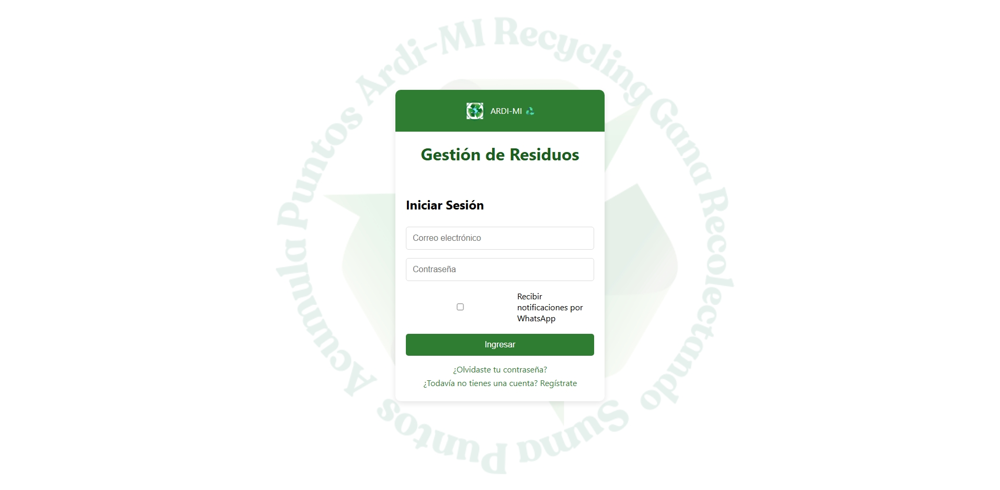
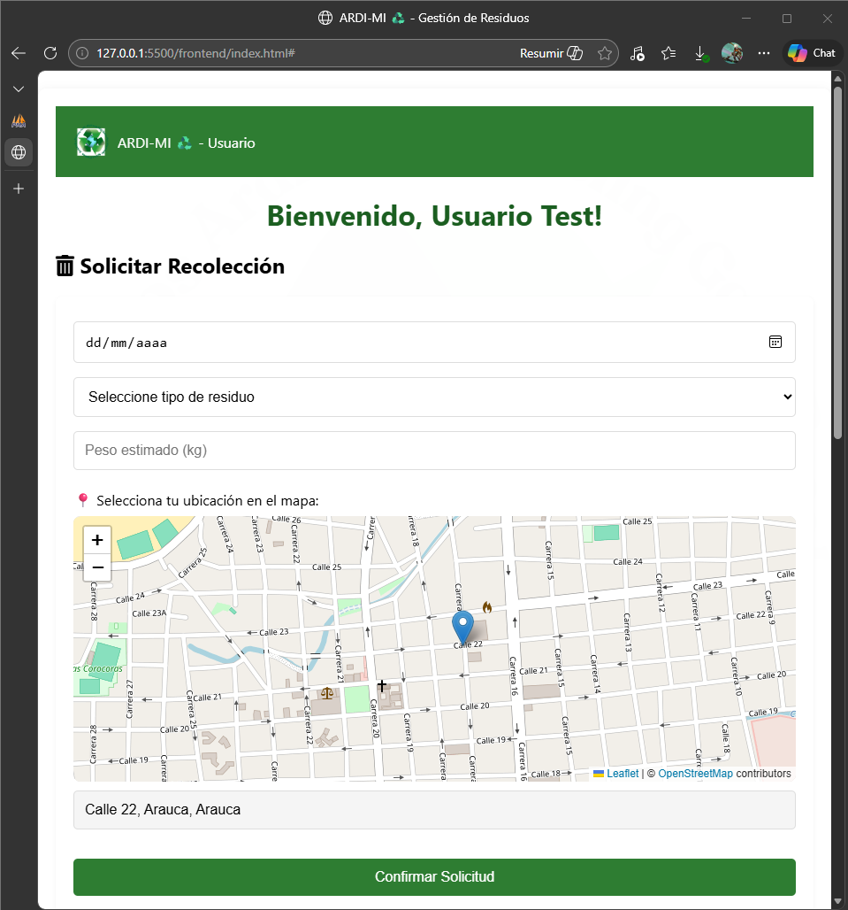
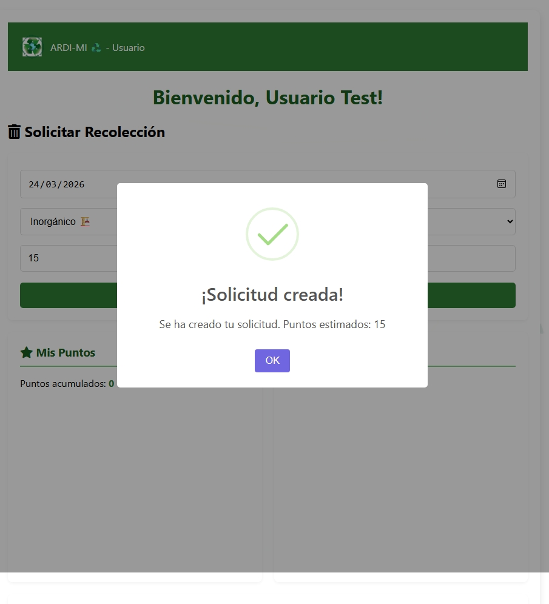
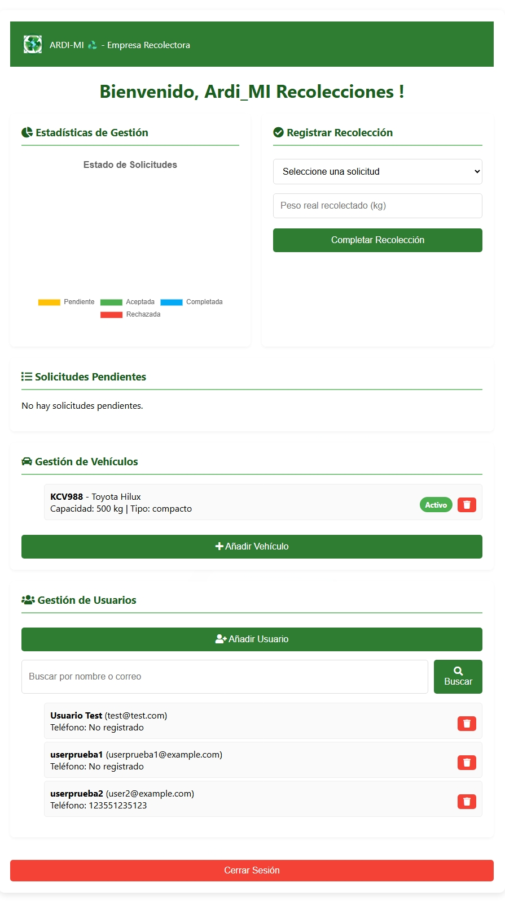
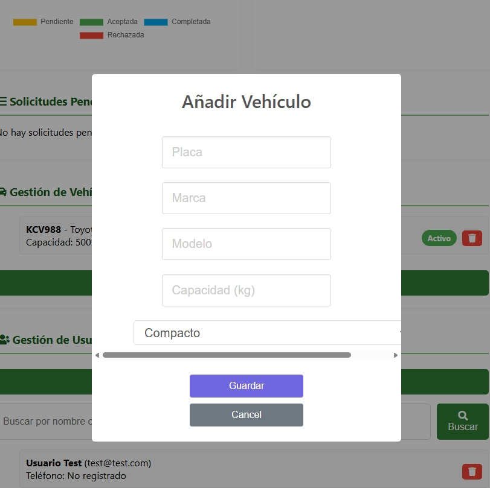

<!-- # ♻️ ARDI-MI - Administración Responsable de Desechos Integrales y Manejo Inteligente


> **🔒 Repositorio Privado**  
> Este código es propiedad de ARDI-MI y no está disponible para uso público.  
> El acceso está restringido exclusivamente al equipo de desarrollo autorizado.

---

## 🏢 Sobre la Compañía

**ARDI-MI** es una empresa dedicada a la **recolección de residuos sólidos** en hogares y comunidades.  
Trabajamos bajo un modelo de suscripción, donde cada hogar o familia contratante tiene derecho a solicitar la recolección de sus desechos de manera ágil, responsable y sostenible.

Nuestro sistema tecnológico permite:

- Gestionar solicitudes de recolección desde los hogares.
- Administrar la flota de vehículos recolectores.
- Asignar rutas de recogida eficientes.
- Calcular puntos por reciclaje para fomentar la cultura ambiental.
- Generar reportes y estadísticas en tiempo real.

---

## 🧩 Funcionalidades del Sistema

### 👤 Para los Usuarios (Hogares)

- **Registro e inicio de sesión** con autenticación segura.
- **Crear solicitudes de recolección** seleccionando:
  - Tipo de residuo (orgánico, inorgánico, reciclable, peligroso)
  - Peso aproximado
  - Ubicación en mapa interactivo (arrastrando un marcador)
- **Historial de solicitudes** con estados: pendiente, aceptada, completada, rechazada.
- **Acumulación de puntos** por cada kg recolectado.
- **Gráfico de puntos** para visualizar el historial de aportes ambientales.
- **Notificaciones en tiempo real** sobre el estado de sus solicitudes.

### 🏭 Para la Empresa (ARDI-MI)

- **Panel administrativo** con vista general del sistema.
- **Gestión de solicitudes pendientes**: aceptar, rechazar o completar recolecciones.
- **Registro de peso real** al completar una recolección (asignación automática de puntos).
- **Gestión de vehículos recolectores**: CRUD completo (placa, marca, modelo, capacidad, tipo).
- **Gestión de usuarios registrados** en la plataforma.
- **Estadísticas visuales** con gráficos de estado de solicitudes.
- **Asignación de rutas** según disponibilidad de vehículos.

---

## 🛠️ Tecnologías Utilizadas

| Capa | Tecnología |
|------|------------|
| **Frontend** | HTML5, CSS3, JavaScript (Vanilla), Leaflet (mapas), Chart.js, SweetAlert2, Toastify |
| **Backend** | Python, FastAPI, Uvicorn |
| **Base de Datos** | MySQL, SQLAlchemy (ORM) |
| **Autenticación** | JWT, bcrypt |
| **Geolocalización** | OpenStreetMap + Leaflet |

---

## 📁 Estructura del Proyecto
ARDI-MI/
├── frontend/ # Interfaz de usuario
│ ├── index.html
│ ├── script.js
│ ├── styles.css
│ └── images/
│
├── ardimi_api/ # Backend FastAPI
│ ├── app/
│ │ ├── auth/ # Autenticación JWT
│ │ ├── models/ # Modelos SQLAlchemy
│ │ ├── routes/ # Endpoints de la API
│ │ ├── schemas/ # Esquemas Pydantic
│ │ ├── database.py
│ │ └── main.py
│ ├── requirements.txt
│ ├── .env
│ └── database.sql
│
└── README.md

text

---

## 🖥️ Pantallas del Sistema

### Inicio de Sesión


### Dashboard del Usuario


### Creación de solicitud


### Dashboard de la Empresa


### Gestión de vehículos


--- -->

# ♻️ ARDI-MI - Administración Responsable de Desechos Integrales y Manejo Inteligente


Este proyecto implementa una solución completa de Integración Continua (CI) para la empresa Ardi-MI. Utiliza **Docker** para la contenerización de microservicios y **Jenkins** como orquestador principal del pipeline de construcción, pruebas y despliegue automatizado.

## 📋 Tabla de Contenidos
1. [Requisitos Previos](#️-requisitos-previos)
2. [Estructura del Proyecto](#-estructura-del-proyecto)
3. [Ejecución Local con Docker (Entrega 1)](#-ejecución-local-con-docker-entrega-1)
4. [Pipeline de Jenkins (Entrega 2)](#-pipeline-de-jenkins-entrega-2)
5. [Prueba de Comunicación Automatizada](#-prueba-de-comunicación-automatizada)
6. [Buenas Prácticas y Seguridad](#-buenas-prácticas-y-seguridad)
7. [Solución de Problemas (Troubleshooting)](#-solución-de-problemas-troubleshooting)

---

## 🛠️ Requisitos Previos

Para ejecutar este proyecto correctamente, asegúrate de tener instalado:
- **Docker Desktop** (Windows/Mac) o Docker Engine (Linux). *Es indispensable para levantar los contenedores.*
- **Git** para clonar el repositorio y gestionar el control de versiones.
- **Jenkins** (Opcional, solo si deseas ejecutar el pipeline localmente). Se incluye un `Dockerfile.jenkins` personalizado para facilitar su despliegue.

---

## 📁 Estructura del Proyecto

El repositorio está organizado de la siguiente manera para separar responsabilidades:

```text
Ardi-MI/
├── .github/workflows/    # Configuración de CI con GitHub Actions (Entrega 1)
├── ardimi_api/           # Código fuente del microservicio (Python/FastAPI)
│   ├── Dockerfile        # Imagen base de la API
│   ├── main.py           # Lógica de endpoints y conexión a DB
│   └── requirements.txt  # Dependencias de Python
├── frontend/             # Interfaz de usuario (carpeta base)
├── .env.example          # Plantilla de variables de entorno (SIN datos reales)
├── docker-compose.yml    # Orquestación de servicios (API + PostgreSQL)
├── Dockerfile.jenkins    # Imagen personalizada de Jenkins con Docker y Compose
├── Jenkinsfile           # Pipeline como código para Jenkins (CI/CD)
└── README.md             # Documentación principal del proyecto
🐳 Ejecución Local con Docker (Entrega 1)
Para levantar el proyecto en tu entorno local y probar la aplicación manualmente, sigue estos pasos:

1. Clonar el repositorio
bash
git clone https://github.com/JuanCardenascj/Ardi-MI.git
cd Ardi-MI
2. Configurar variables de entorno
Copia el archivo de ejemplo y renómbralo. Nunca subas el archivo .env real al repositorio.

bash
cp .env.example .env
Abre el archivo .env recién creado y asigna valores seguros para:

DB_NAME (Nombre de la base de datos)

DB_USER (Usuario de PostgreSQL)

DB_PASSWORD (Contraseña del usuario)

3. Levantar los servicios
bash
docker compose up -d
Este comando construirá las imágenes necesarias, creará la red interna y levantará los contenedores en segundo plano.

4. Verificar el estado
bash
docker ps
Deberías ver dos contenedores corriendo: ardi_api (puerto 8000) y ardi_db (PostgreSQL 15).

5. Acceder a la API
La API estará disponible en http://localhost:8000. Puedes probar el endpoint de salud en http://localhost:8000/docs.

⚙️ Pipeline de Jenkins (Entrega 2)
El pipeline está definido como código en el archivo Jenkinsfile. Jenkins no solo construye las imágenes, sino que valida la comunicación entre los contenedores antes de dar el visto bueno.

Etapas del Pipeline:
Checkout: Clona el código fuente más reciente desde la rama main de GitHub.

Build: Inyecta las variables de entorno necesarias de forma temporal y ejecuta docker compose build para construir las imágenes de la API y la Base de Datos.

Test (Prueba Real): Levanta los contenedores con docker compose up -d, espera 15 segundos a que la DB esté lista y ejecuta un script interno de Python dentro del contenedor ardi_api para hacer una petición POST al endpoint /solicitudes. Si la API no responde con Status 200, el pipeline falla.

Post-actions: Se ejecuta siempre (always). Limpia el entorno con docker compose down -v para no dejar volúmenes ni contenedores huérfanos.

¿Cómo ejecutar Jenkins localmente?
Construir la imagen personalizada de Jenkins (incluye Docker y Compose):

bash
docker build -t mi-jenkins-docker -f Dockerfile.jenkins .
Levantar el contenedor de Jenkins:
(Nota: Se mapea el socket de Docker para que Jenkins pueda crear contenedores en tu máquina host).

bash
docker run -d --name jenkins-ardi -p 8080:8080 -p 50000:50000 \
  -v jenkins_home:/var/jenkins_home \
  -v /var/run/docker.sock:/var/run/docker.sock \
  mi-jenkins-docker
Obtener contraseña inicial:

bash
docker exec jenkins-ardi cat /var/jenkins_home/secrets/initialAdminPassword
Configurar el Job en la interfaz web (http://localhost:8080):

Tipo: Pipeline.

Configuración: Pipeline script from SCM.

URL del repositorio: https://github.com/JuanCardenascj/Ardi-MI.git.

Rama: */main.

Ruta del script: Jenkinsfile.

Ejecutar: Haz clic en Build Now.

🧪 Prueba de Comunicación Automatizada
El punto central de la Integración Continua es que el pipeline verifique que la aplicación realmente funciona. Dado que la imagen de Python es ligera (no trae curl), el Jenkinsfile utiliza el propio intérprete de Python dentro del contenedor para hacer la prueba:

bash
docker exec ardi_api python -c "
import urllib.request, json
data = json.dumps({'tipo_residuo': 'prueba_jenkins', 'direccion': 'Calle Falsa 123'}).encode('utf-8')
req = urllib.request.Request('http://localhost:8000/solicitudes', data=data, headers={'Content-Type': 'application/json'})
try:
    response = urllib.request.urlopen(req)
    print('Status:', response.status)
except Exception as e:
    exit(1)
"
Si el comando anterior devuelve un Status 200, significa que la API se comunicó exitosamente con PostgreSQL usando el nombre del servicio (db).

🔒 Buenas Prácticas y Seguridad
Este repositorio implementa los siguientes estándares de seguridad e ingeniería:

Credenciales protegidas: Las contraseñas de la base de datos y los tokens de GitHub NUNCA se escriben en el código fuente (ni en el Jenkinsfile).

Uso de plantillas: Se incluye un archivo .env.example para que otros desarrolladores sepan qué variables necesitan, mientras que el archivo .env real está protegido en el .gitignore.

Red interna de Docker: Los contenedores se comunican a través de la red ardi_network usando DNS interno (ej. db) en lugar de IPs fijas, garantizando portabilidad.

Limpieza de entorno: El pipeline destruye sus propios recursos al terminar, evitando la acumulación de basura en el disco (docker compose down -v).

🚑 Solución de Problemas (Troubleshooting)
Si Jenkins falla al ejecutar el pipeline, verifica estos puntos:

Error de permisos en el socket: Ocurre si Jenkins no está corriendo con el usuario correcto. Solución: Asegúrate de ejecutar el contenedor de Jenkins con -v /var/run/docker.sock:/var/run/docker.sock.

Error curl: command not found: Es un error esperado si se intenta usar curl en la imagen de Python slim. Ya está solucionado en este repositorio usando un script interno de Python.

Error de variables de entorno: Verifica que el Jenkinsfile esté inyectando correctamente las variables DB_NAME, DB_USER y DB_PASSWORD antes de llamar a docker compose up.